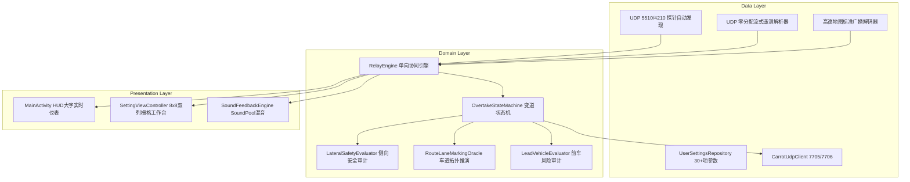

# AmapNavi-Reborn 软件架构与详细设计说明书

## 一、系统架构全景

`AmapNavi-Reborn` 采用单向数据流与整洁架构（Clean Architecture）原则，分为三层：

---

## 二、车机底层三大技术突破

### 1. 零对象分配流式扫描器 (`FastTelemetryScanner`)
针对 Android 4.4 Dalvik 虚拟机缺乏并发压缩 GC 的致命弱点，在处理每秒 20~50 个高频 UDP 遥测数据包时，废除 `org.json.JSONObject`，改用纯基于字符串游标切片的扫描器：
- 逐字符累加整数与浮点数，直接输出基本数据类型；
- 全流程**零 HashMap、零中间对象分配**，彻底消灭 Dalvik 的 `GC_FOR_ALLOC` 全局挂起停顿。

### 2. 同窗即时渲染架构 (In-Window SAA)
- 设置工作台废除跨 Activity 启动机制（消除跨进程 `ActivityManagerService` 调度 400ms 延迟）；
- 通过 `ViewStub` 惰性挂载在主窗口内部，页面进入与返回在 **`< 0.1 ms` 内存微秒级瞬发**；
- 8x8 双列栅格排布 16 组步进调节器，一屏通览免滑动。

### 3. PSS 15.5MB 内存极限制约与倒车影像保活
- 库斯途车机可用物理运存仅约 350MB，高德自身占 209MB；
- 本系统常驻内存严格控制在 **15.5 MB**，为系统保留 140MB+ 缓冲，确保挂入 R 挡时原厂倒车影像毫秒级出图，杜绝黑屏死机。
